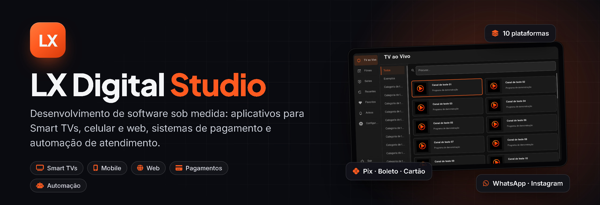
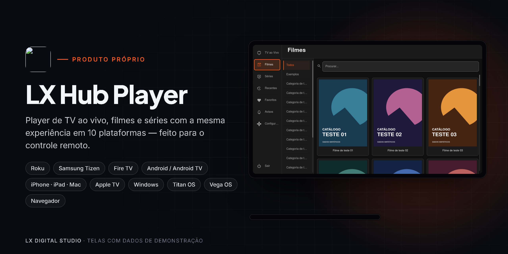
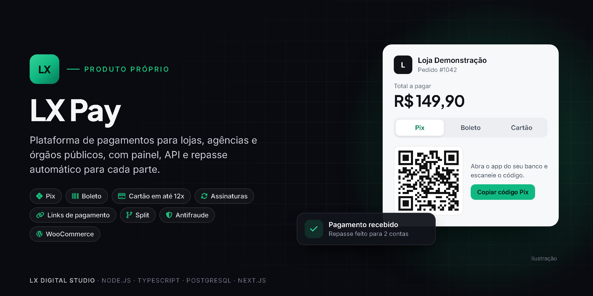
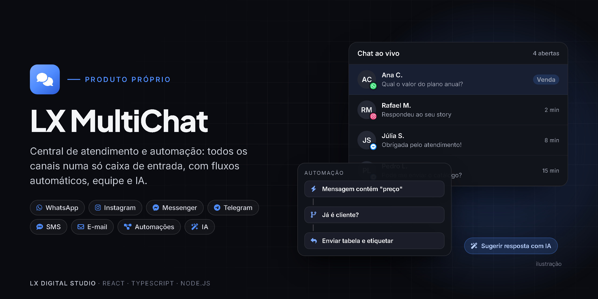
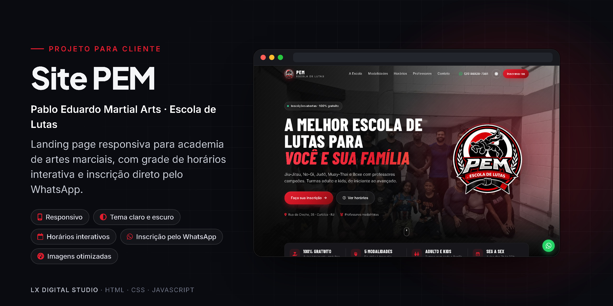
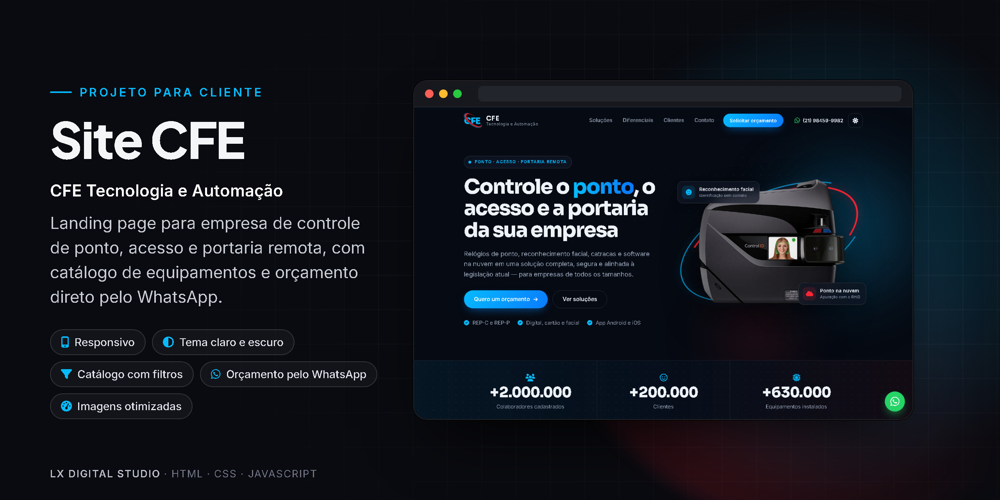

  

  <b>Aplicativos para Smart TVs, celular e web · Sistemas de pagamento · Automação de atendimento</b>

  

---

## Sobre a LX Digital Studio

Somos um estúdio de desenvolvimento que cria produtos digitais de ponta a ponta: da interface ao servidor, do controle remoto da TV ao pagamento por Pix. Abaixo estão nossos produtos próprios e trabalhos feitos para clientes.

> 🔒 **O código-fonte dos projetos é privado.** Demonstrações ao vivo e acesso para avaliação técnica podem ser combinados sob pedido.

---

## Projetos

### LX Hub Player

Player de TV ao vivo, filmes e séries com a mesma experiência em **10 plataformas**, pensado para ser usado com o controle remoto.

- **Plataformas:** Roku, Samsung (Tizen), Amazon Fire TV, Android e Android TV, iPhone, iPad e Mac, Apple TV, Windows, Titan OS, Vega OS e navegador.
- **Destaques:** entrada por Xtream Codes ou lista M3U, catálogo com busca, favoritos e recentes, avisos, controle parental com PIN e três idiomas (português, inglês e espanhol).
- **Tecnologias:** Flutter e Dart, TypeScript, BrightScript e Swift.

 

### LX Pay

Plataforma de pagamentos para lojas, agências e órgãos públicos, com painel de gestão, API para desenvolvedores e divisão automática dos valores entre as partes.

- **Formas de pagamento:** Pix, boleto, cartão de crédito em até 12x, assinaturas recorrentes e links de pagamento.
- **Para o negócio:** painel com verificação em duas etapas e permissões por equipe, split entre parceiros, antecipação de recebíveis, antifraude, saldo e saques, revenda para agências e emissão de guias para órgãos públicos.
- **Para desenvolvedores:** API REST com avisos assinados (webhooks), bibliotecas para JavaScript e PHP e plugin para WooCommerce.
- **Tecnologias:** Node.js, TypeScript, Fastify, PostgreSQL e Next.js.

 

### LX MultiChat

Central de atendimento e automação: todas as conversas numa só caixa de entrada, com fluxos automáticos, trabalho em equipe e inteligência artificial.

- **Canais:** WhatsApp (API oficial), Instagram Direct, Messenger, Telegram, SMS e e-mail.
- **Destaques:** chat ao vivo com responsáveis e notas internas, automações visuais com condições e perguntas, disparos e sequências, segmentos de contatos e IA para sugerir respostas e classificar mensagens.
- **Tecnologias:** React, TypeScript, Node.js e SQLite.

 

### Site PEM – Escola de Lutas · *projeto para cliente*

Landing page para uma academia de artes marciais, com grade de horários interativa, apresentação dos professores e inscrição direto pelo WhatsApp.

- **Destaques:** layout responsivo, tema claro e escuro, horários com filtro por modalidade e imagens otimizadas para carregar rápido.
- **Tecnologias:** HTML, CSS e JavaScript.

 

### Site CFE – Tecnologia e Automação · *projeto para cliente*

Landing page para uma empresa de controle de ponto, controle de acesso e portaria remota, com catálogo de equipamentos e pedido de orçamento direto pelo WhatsApp.

- **Destaques:** layout responsivo, tema claro e escuro, catálogo com filtro por categoria, formulário de orçamento com validação e imagens otimizadas para carregar rápido.
- **Tecnologias:** HTML, CSS e JavaScript.

---

## O que fazemos

| | |
|---|---|
| 📺 **Apps para Smart TVs** | Roku, Samsung, Fire TV, Android TV, Apple TV, Titan OS e Vega OS |
| 📱 **Apps para celular e computador** | Android, iPhone, iPad, Mac e Windows |
| 🌐 **Sites e sistemas web** | Landing pages, painéis administrativos e plataformas SaaS |
| 💳 **Pagamentos** | Pix, boleto, cartão, assinaturas, split e integrações com lojas |
| 🤖 **Automação de atendimento** | WhatsApp, Instagram e outros canais, com fluxos e IA |

## Tecnologias

  
  
  
  
  
  
  
  
  
  
  
  
  
  

## Vamos conversar?

Tem um projeto em mente? Escreva para **[lxdigitalstudio7@gmail.com](mailto:lxdigitalstudio7@gmail.com)** e conte o que você precisa.

© LX Digital Studio · imagens de telas com dados de demonstração

